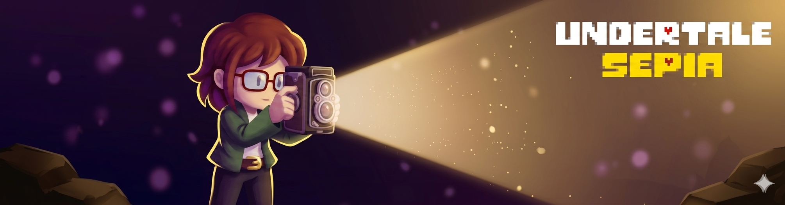

# Undertale Sepia

**An Undertale fangame set five years after the True Pacifist ending.**
The barrier is gone, the monsters live on the surface, and the Underground is almost empty. Then a photographer falls in.

> [!NOTE]
> **In development.** This repository holds the GameMaker project for the Sepia demo. There is no playable release yet — see [Status](#status).

---

## The story

Arianne came to Mt. Ebott to photograph what was left after the barrier broke. She leaned in too far for the shot, and fell.

She lands in an Underground that everyone has walked away from: lights still on in houses nobody lives in, machines still running with no one to tend them. All she has is her camera — and, in the places too deep for any light to reach, its flash is the only way to see.

But not everyone left.

**How much harm is acceptable when you're just trying to survive?**

### Arianne

An adult, quiet and observant, with a brown SOUL of **Sincerity**. She isn't a silent protagonist: she speaks rarely, and when she does she says exactly what she means. Where other heroes play along with the monsters' quirks, she waits, watches, and tells the truth.

## The demo

The demo covers Arianne's whole first chapter, from the fall to the moment she leaves the Ruins:

- **The Ruins** — the familiar path, until it isn't.
- **The Deep Ruins** — a flooded, pitch-dark sub-basement beneath the Ruins: an old dig the monsters once called *the Way Out*.
- **Old Home** — the first monster capital, abandoned long ago and somehow still lit.
- **The boss** — someone who has been guarding a house for five years, and isn't about to let a stranger in.

## Features

- **The flash.** In the Deep Ruins you can't see past arm's length. The camera's flash lights the whole screen for a moment, then fades — and the room remembers what it lit as a faint sepia outline, like a photograph developing. A charge bar paces it.
- **Photos and the album.** Find photo spots, take the shot, and keep it in an album with Arianne's own captions. What you choose to record matters at the end.
- **Undertale-style battles.** FIGHT, ACT, ITEM and MERCY. Arianne's ACTs are quiet honesty — *Wait*, *Point Out* — and the camera is an ACT too: a flash stuns a monster for two turns and hurts it a little, but it can never kill.
- **Routes the game never announces.** Pacifist, Flash, Neutral and Genocide. You'll feel which one you're on in the music, in Arianne's words, and in how the Underground answers you.
- **Keyboard and gamepad.**

> [!WARNING]
> **Photosensitivity:** the game uses bright full-screen flashes. A reduced-flash setting replaces the white burst with a dimmer sepia one — set `ReducedFlash=1` under `[Settings]` in the game's `settings.ini`.

## Controls

| Action | Keyboard | Gamepad |
|---|---|---|
| Move | Arrow keys | D-pad |
| Confirm / interact / take a photo | Z or Enter | A / Cross |
| Cancel · hold to run | X or Shift | B / Circle |
| Menu (items, stats, journal) | C or Ctrl | X / Square or Start |
| Camera flash | F | Y / Triangle or RB / R1 |
| Fullscreen | F4 | — |
| Quit | Hold Esc | Hold Select / Back |

Photos are taken at photo spots: when the camera icon appears over Arianne, press Z.

## Status

What exists today and what's still to come for the demo:

- [x] Undertale-style battle system with data-driven enemies (JSON)
- [x] Overworld flash, room memory and charge bar (tuning in progress)
- [x] Photo spots and the album (the journal art is placeholder)
- [x] Route tracking: Pacifist, Flash, Neutral, Genocide
- [x] Overworld hazards and stairs
- [x] The Long Climb's rotating spiral staircase (prototype)
- [ ] The Ruins and the Deep Ruins — the first stretch is built; the rest is in progress
- [ ] Old Home
- [ ] Monsters — designed; sprites and encounters to come
- [ ] The boss fight
- [ ] Music
- [ ] A playable demo build

Beyond the demo, the full game is planned to continue through Snowdin, Waterfall, Hotland, the CORE and New Home.

## Credits

- **Undertale Sepia** — created by **Justin Era Antonio**.
- **UNDERTALE** — by Toby Fox. Sepia is set in its world and builds on its story.
- **Undertale Yellow** — by Team Undertale Yellow. Sepia also draws on its lore.
<!-- TODO: credit the open-source Undertale engine this project started from (engine v0.6.0): its name, author and link. -->

## Disclaimer

Undertale Sepia is a free, non-commercial fan project. It is not affiliated with or endorsed by Toby Fox or Team Undertale Yellow. UNDERTALE and its characters, art and music belong to Toby Fox; Undertale Yellow belongs to its creators.

No license has been chosen for this repository yet, so the original code, art, writing and music here are © Justin Era Antonio, all rights reserved.
